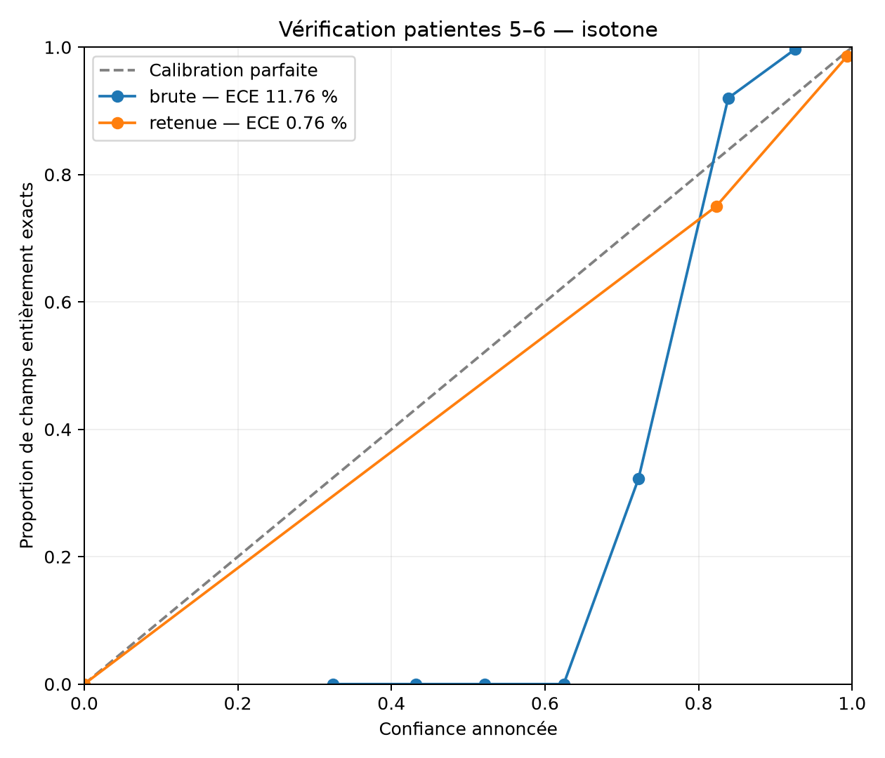
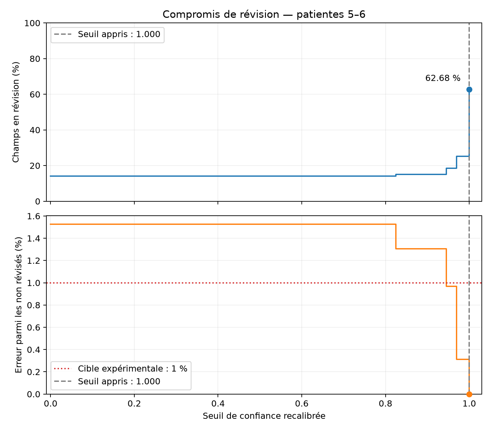

# Évaluation : vérité terrain, scores et calibration

Ce dossier mesure l'extraction du spécimen synthétique avec `extraction.pipeline.extract_page()`, sans modifier le pipeline. Le développement couvre **les pages 1–48, patientes 1–6**. Les pages 49–80 restent réservées à une évaluation finale unique, au gel du modèle et sur autorisation explicite ; cette évaluation finale n'a pas été lancée.

## Installation et vérifications

Depuis la racine du dépôt, dans PowerShell :

```powershell
python -m venv evaluation/.venv
& evaluation/.venv/Scripts/python.exe -m pip install -r evaluation/requirements.txt -r extraction/requirements.txt
& evaluation/.venv/Scripts/python.exe -B shared/valider.py evaluation/verite_terrain.json
& evaluation/.venv/Scripts/python.exe -B -m unittest discover -s evaluation -p 'test_*.py'
```

Réutiliser l'environnement s'il existe déjà. Les vérifications actuelles donnent `VALIDE` et **42 tests réussis**. Les appels non cachés nécessitent `ANTHROPIC_API_KEY` dans `evaluation/.env` ou l'environnement ; ne jamais commiter cette clé. La validation, la génération des dégradations et la calibration ne nécessitent aucun appel API.

Le générateur de vérité terrain utilise `pdftotext`, recherché dans le PATH puis dans Git pour Windows. Si nécessaire, passer `--pdftotext 'C:\chemin\pdftotext.exe'`. PyMuPDF sert notamment à vérifier les colonnes vides et préparer les aperçus ; scikit-learn sert à la calibration.

## Méthode

La source est `data/Paper Registry/dossiers_specimen_10_patientes.pdf` et ses PNG. Les doublons sont identifiés par SHA-256 : **48 images propres uniques**, avec **36 copies ignorées** dans le dev. Les empreintes du PDF, des PNG et des annotations sont vérifiées avant utilisation. Les cinq vraies photos du registre ne font pas partie de cette expérience.

La couche texte UTF-8 est lue en modes `raw` et `layout`, puis complétée par des annotations visuelles persistantes. L'image fait foi lorsque les glyphes du texte sont incomplets. Le corpus suit [les conventions communes](../shared/CONVENTIONS.md), notamment les sections 3 et 7 : case unique vide `CONNU false`, liste sans objet `NON_APPLICABLE null`, liste vide lors d'une consultation réalisée `CONNU []`, visite entièrement vide `NON_APPLICABLE`. Le niveau d'instruction « Aucun » reste une valeur ; les familles à deux colonnes et les accouchements antérieurs suivent leurs formats communs. `anomalie`, `vaccins_du_jour` et les listes d'accouchements sont intégrés au dev et acceptés par le validateur.

Les identifiants internes sont des UUID aléatoires. Le texte brut des sources reste en mémoire ; les annotations et rapports ne conservent aucun nom, prénom, CIN, téléphone ou adresse. Pour le personnel, seule la fonction est retenue. La confiance 1 des annotations représente la référence, pas la confiance du modèle ni une validation humaine indépendante.

La comparaison applique les tolérances fixées à l'étape 3 : décimaux ±0,1, poids ±10 g, chaque composante de tension ±1 mmHg, autres entiers exacts. Les textes libres utilisent RapidFuzz `ratio` ≥85/100 après normalisation des accents, ligatures, casse et espaces ; les textes courts, numéros de fiche, choix et dates restent stricts. Une différence de mots de négation bloque la comparaison floue. Les listes de choix sont comparées sans ordre ni doublons ; les objets d'accouchement gardent l'ordre et les sous-clés, avec textes normalisés et tolérance de poids.

Les métriques exigent le bon type de page :

- **Valeurs** : valeurs correctes / références non nulles. Les valeurs rendues pour une référence vide sont pénalisées dans le score de champs.
- **Statuts** : statuts corrects / tous les champs annotés, y compris les raisons d'absence.
- **Champs entièrement exacts** : valeur correcte selon les tolérances et statut exact / tous les champs annotés.
- **Couverture de l'extraction** : champs valides présents / champs annotés. Les champs absents et les échecs d'appel restent des erreurs dans les dénominateurs.

Les champs non annotés seraient exclus et leur nombre publié. Les diagnostics du pipeline sont remplacés par des catégories fixes ; les rapports de comparaison ne contiennent aucune valeur prédite. Le cache local des lectures intermédiaires reste dans `evaluation/cache/`, hors Git.

## Résultats du développement

Ces résultats utilisent le pipeline livré, fournisseur Anthropic et modèle déclaré `claude-sonnet-5`, avec la référence enrichie aux étapes 1–4. Les agrégats et empreintes sont versionnés dans [bilan_degradations_dev.json](bilan_degradations_dev.json). Le cache des lectures propres a été réutilisé ; les scores sont recalculés contre la référence complète. Les anciens scores du pipeline simulé et de l'étape 3 sur une référence partielle ne décrivent pas cette expérience.

### Couverture des annotations

Le dev contient **1 470 champs annotés sur 1 470 possibles (100 %)** et **0 champ non annoté**. Il comprend **1 028 valeurs non nulles**, 442 absences codées et **278 annotations visuelles persistantes** ; les autres champs proviennent de la couche texte et des règles automatiques. Les neuf visites sont représentées par leurs champs, y compris les 18 colonnes entièrement vides.

La couverture est détaillée dans [couverture_dev.json](couverture_dev.json) et [A_ANNOTER_DEV.md](A_ANNOTER_DEV.md). La liste historique `A_ANNOTER.md` inclut le jeu réservé et ne représente pas les manques du dev. Le corpus reste **`A_REVISER`** : une relecture humaine indépendante est encore nécessaire. Le générateur ne régénère que les pages 1–48 et préserve les références historiques 49–80.

### Pages propres : scores globaux et par type

Les 48 sorties sont valides et les 1 470 champs prédits sont présents : couverture d'extraction **100 %**. Les valeurs sont correctes à **1 028/1 028 (100 %)** ; les statuts et champs entièrement exacts à **1 453/1 470 (98,84 %)**.

Chaque type comprend six pages :

| Type de page | Champs annotés | Valeurs | Statuts | Champs entièrement exacts |
|---|---:|---:|---:|---:|
| Identification | 48 | 100,00 % | 97,92 % | 97,92 % |
| Antécédents | 138 | 100,00 % | 96,38 % | 96,38 % |
| Grossesse actuelle | 960 | 100,00 % | 99,69 % | 99,69 % |
| Accouchement | 72 | 100,00 % | 98,61 % | 98,61 % |
| Post-partum précoce, mère | 60 | 100,00 % | 98,33 % | 98,33 % |
| Post-partum précoce, nouveau-né | 66 | 100,00 % | 98,48 % | 98,48 % |
| Post-partum tardif, mère | 60 | 100,00 % | 95,00 % | 95,00 % |
| Post-partum tardif, nouveau-né | 66 | 100,00 % | 96,97 % | 96,97 % |

Les 17 écarts de statut sont 15 références `CONNU` rendues `A_REVISER` et deux `NON_FOURNI` rendues `CONNU`. Un statut de révision prudent constitue un désaccord sans nécessairement signaler une mauvaise lecture. Les 960 champs de grossesse représentent 65,3 % du total ; le score global n'est pas une moyenne équilibrée des huit types.

### Images dégradées

Le script livré `extraction/degrader.py` génère **288 images : 48 pages × six dégradations**, avec sa graine fixe. Chaque variante reprend la vérité terrain de sa page d'origine. Le répertoire de sortie est redirigé en mémoire vers `evaluation/degradees/`, sans modification du script. Le type de page est connu par l'index : cette expérience mesure l'extraction des champs avec type connu, pas la classification d'une page inconnue.

| Images | Sorties valides / 48 | Valeurs | Statuts | Champs entièrement exacts |
|---|---:|---:|---:|---:|
| Propres | 48 | 100,00 % | 98,84 % | 98,84 % |
| Flou | 48 | 85,41 % | 69,80 % | 68,30 % |
| Rotation | 44 | 62,45 % | 54,42 % | 54,22 % |
| Ombre | 48 | 99,90 % | 98,91 % | 98,91 % |
| Sous-exposition | 48 | 99,90 % | 99,32 % | 99,32 % |
| JPEG | 48 | 99,03 % | 98,50 % | 98,23 % |
| Combinaison | 46 | 67,22 % | 53,27 % | 52,38 % |

Le flou et la combinaison réduisent nettement la qualité. La rotation comprend quatre échecs du pipeline, pages 11, 19, 27 et 35 ; la combinaison en comprend deux, pages 3 et 19. Ces six échecs représentent **960 champs absents**, pénalisés dans les scores. Leur cause précise n'est pas identifiée ; toute la baisse ne peut pas être attribuée à une mauvaise lecture visuelle. Les faibles écarts pour l'ombre, la sous-exposition et le JPEG ne démontrent pas une amélioration, avec une seule réalisation par image et la variabilité du modèle.

Le [bilan des dégradations](ETAPE_5_DEGRADATIONS_DEV.md) donne aussi les champs entièrement exacts par type de page et par dégradation. Le JSON versionné conserve leurs numérateurs, dénominateurs et scores de valeurs et statuts.

### Calibration et seuil recommandé

Avec l'accord de l'utilisateur, la calibration utilise les confiances finales des comparaisons de l'étape 5 : les fichiers détaillés `extraction/sorties/<variante>/page_<NN>.json` avec signaux ne sont pas encore disponibles. Les signaux manquants ne sont pas inventés. Les sept variantes fournissent **10 290 observations de champs**, dont **9 330 avec confiance**. Les 960 observations sans confiance sont exclues de l'ECE et systématiquement envoyées en révision.

L'ECE utilise dix intervalles de largeur 0,1 et pondère les écarts entre confiance moyenne et exactitude réelle par leurs effectifs. La cible reste le champ entièrement exact. La confiance brute, la régression logistique et la régression isotone sont comparées par validation croisée laissant une patiente de 1–4 de côté, avec toutes ses variantes regroupées. L'isotone est retenue au plus petit Brier, puis apprise sur les patientes 1–4 : **6 060 champs avec confiance**. La fonction est vérifiée sur les patientes 5–6 : **3 270 champs avec confiance**.

| Vérification, patientes 5–6 | Confiance brute | Recalibration isotone |
|---|---:|---:|
| ECE | 11,76 % | 0,76 % |
| Brier | 0,04913 | 0,01396 |



Le seuil expérimental recommandé est **1,00 sur la confiance recalibrée**, correspondant ici à une confiance finale brute **≥0,92** sur le plateau isotone. Les champs absents, sans confiance, de mauvais type, de statut `A_REVISER`, `ILLISIBLE` ou `INCONNU`, ou de confiance brute <0,75 restent obligatoirement en révision. Ce seuil n'est pas appliqué au pipeline et ne signifie pas une certitude réelle de 100 %.

Il est choisi sur les patientes 1–4 pour minimiser la révision avec au plus 1 % d'erreurs parmi les non révisés **dans chaque variante d'apprentissage**. En vérification, il révise **2 150/3 430 champs (62,68 %)** et laisse **0 erreur observée sur 1 280 champs non révisés**. Un critère limité à la moyenne avait été trop permissif ; les critères ont été explorés pendant le dev. Cette vérification reste exploratoire, sans constituer un test indépendant final de la politique choisie.



La [méthode de calibration](ETAPE_6_CALIBRATION_DEV.md) présente les scores et la révision par variante. [figures/calibration_dev.json](figures/calibration_dev.json) conserve les paramètres appris, les points des courbes, les versions des bibliothèques et les empreintes des sources. Les deux figures PNG sont versionnées.

### Score officiel sur le jeu de test (patientes 7 à 10)

**Conditions** :
- évaluation lancée **une seule fois**, après gel du modèle et sur autorisation explicite, sur les pages 49 à 80 ;
- 32 pages uniques, 4 de chaque type, 8 doublons ignorés ; patientes jamais vues pendant le développement ;
- pipeline et seuil inchangés (`claude-sonnet-5`, seuil de question 0,92) ;
- commandes : `extraction/lot.py --split test --autoriser-test`, puis
  `evaluation/evaluer.py --pages 49-80 --autoriser-test` ;
- agrégats versionnés dans [score_test_final.json](score_test_final.json).

**Extraction** : 32 sorties valides sur 32 et 32 types de page corrects. 30 appels, **1,61 $**, **623 s** au total ;
2 pages étaient déjà en cache.

**Couverture de la référence** : la référence du test est **partielle**, 619 champs annotés sur 980 (63,2 %),
issus des annotations historiques. Les 361 champs non annotés sont exclus des scores.

| Mesure, jeu de test | Résultat |
|---|---:|
| Valeurs exactes | **547/553 (98,92 %)** |
| Statuts exacts | 336/619 (54,28 %) |
| Champs entièrement exacts (valeur et statut) | 332/619 (53,63 %) |
| Valeurs fausses sans alerte au seuil 0,92 | **4/619 (0,65 %)**, soit 4 sur les 342 champs non révisés (1,17 %) |
| Valeur rendue sans alerte pour une case vide dans la référence | 13/619 |
| Questions posées par page | moyenne 11,4 ; médiane 3,5 ; minimum 0 ; maximum 156 |

**Lecture des statuts** : l'écart vient surtout du seuil de 0,92.
- 224 champs que la référence donne `CONNU` sont rendus `A_REVISER`. La valeur lue est le plus souvent juste,
  mais elle est envoyée en question par prudence.
- 40 cases vides (`NON_FOURNI`) sont aussi rendues `A_REVISER`.

Ces champs coûtent une question à la sage-femme ; ce ne sont pas des erreurs silencieuses. Sur les 277 champs mis
en question, 48 cachaient effectivement une erreur de valeur ou de statut.

| Type de page | Champs annotés | Valeurs | Statuts | Champs exacts | Questions par page (moyenne) |
|---|---:|---:|---:|---:|---:|
| Identification | 31 | 100,00 % | 58,06 % | 58,06 % | 2,5 |
| Antécédents | 76 | 91,67 % | 69,74 % | 64,47 % | 6,8 |
| Grossesse actuelle | 318 | 99,66 % | 43,08 % | 43,08 % | 65,0 |
| Accouchement | 43 | 100,00 % | 58,14 % | 58,14 % | 4,0 |
| Post-partum précoce, mère | 39 | 100,00 % | 76,92 % | 76,92 % | 2,5 |
| Post-partum précoce, nouveau-né | 36 | 100,00 % | 66,67 % | 66,67 % | 3,2 |
| Post-partum tardif, mère | 40 | 100,00 % | 75,00 % | 75,00 % | 2,0 |
| Post-partum tardif, nouveau-né | 36 | 100,00 % | 52,78 % | 52,78 % | 5,2 |

**Comparaison avec le développement** :
- les valeurs restent au même niveau (98,9 % contre 100 %) ;
- les statuts et les champs entièrement exacts baissent nettement, parce que les scores de développement ont été
  calculés avec l'ancien seuil de 0,75, avant la calibration ;
- le seuil de 0,92 privilégie l'absence d'erreur silencieuse au prix de questions, surtout sur les pages de
  grossesse (65 questions par page en moyenne, jusqu'à 156) ;
- les 13 valeurs rendues pour une case vide restent à confirmer, car la référence du test n'a pas été relue
  comme celle du développement.

### Limites et évaluation finale

La référence nécessite une relecture humaine indépendante. Les données sont synthétiques, avec six patientes seulement ; la vérification de calibration n'en compte que deux. Les pages propres et leurs variantes sont corrélées : les 10 290 observations ne sont pas indépendantes. Certaines variantes ne gardent que peu de champs sans révision, par exemple 30 pour la combinaison en vérification. Zéro erreur observée ne garantit pas une erreur réelle nulle.

La similarité textuelle ne prouve pas l'équivalence sémantique. Les scores incluent la justesse des statuts, les champs sans objet et les absences ; ils sont sensibles aux conventions et au poids des pages de grossesse. Les signaux détaillés manquants empêchent d'analyser séparément la confiance du modèle, la plausibilité et la cohérence. Ces résultats n'établissent pas une performance sur de vraies photos de registre.

**Évaluation finale réalisée** : les pages 49–80 ont été utilisées une seule fois, après gel du modèle (section « Score officiel » ci-dessus). Elles ne doivent plus servir à ajuster le pipeline ni le seuil. `evaluer.py` les refuse toujours sans `--autoriser-test`. La référence du test reste partielle (63,2 % des champs annotés).

## Reproduire et relire

Pour relire les cases dans une interface locale, sans appel API :

```powershell
& evaluation/.venv/Scripts/python.exe -B evaluation/reviser_cases_dev.py
```

Ouvrir `evaluation/apercus/revision_dev/index.html`. Les corrections téléchargées sont importées explicitement ; voir [les annotations du dev](ETAPE_4_ANNOTATIONS_DEV.md). Les modifications persistantes vont dans `annotations_manuelles.json`, puis la vérité terrain est régénérée : une correction faite seulement dans `verite_terrain.json` serait écrasée.

```powershell
& evaluation/.venv/Scripts/python.exe -B evaluation/verite_terrain.py
& evaluation/.venv/Scripts/python.exe -B shared/valider.py evaluation/verite_terrain.json
& evaluation/.venv/Scripts/python.exe -B evaluation/couverture_dev.py
```

La régénération change l'empreinte de la référence ; relancer ensuite les scores et la calibration. Pour les pages propres, puis les six variantes et leur comparaison :

```powershell
& evaluation/.venv/Scripts/python.exe -B evaluation/evaluer.py --sortie evaluation/resultats_dev --etiquette ia-dev
& evaluation/.venv/Scripts/python.exe -B evaluation/evaluer_degradees.py --generer-seulement
& evaluation/.venv/Scripts/python.exe -B evaluation/evaluer_degradees.py --jobs 3
& evaluation/.venv/Scripts/python.exe -B evaluation/calibrer.py --utiliser-comparaisons
```

`--generer-seulement` contrôle les images et empreintes sans réseau. Les évaluations réutilisent le cache ; les appels non cachés utilisent l'API et peuvent être longs. Les scores sont écrits dans des sous-dossiers de `evaluation/` : rapport Markdown, scores JSON et CSV, confusion des statuts, comparaisons par champ sans valeurs. Un code 2 signale des sorties invalides ou appels échoués, avec les erreurs incluses dans le bilan. Le repli de calibration exige `--utiliser-comparaisons` ; ses résultats d'étape 5 doivent être présents localement et correspondre à la référence actuelle.

Images générées, aperçus, cache, `.env` et résultats détaillés restent hors Git. Les agrégats publiés dans ce README sont une photographie de l'expérience versionnée ; une nouvelle exécution peut donner d'autres scores et nécessite leur mise à jour. Les figures et agrégats versionnés restent consultables sans relancer l'API. Seul `evaluation/` est modifié ; `data/`, `shared/` et `extraction/` restent inchangés.
